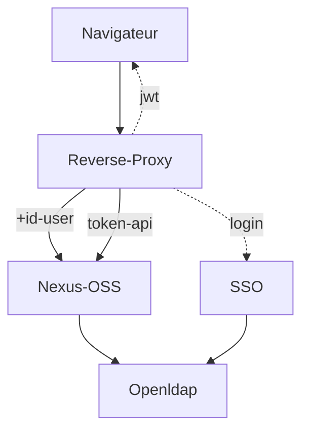

# oidc_reverse_proxy - Reverse Proxy SSO Openid connect

__Comming soon ...__

This Golang application for Agréments is used to:

* centralize tools on a single entry point (front end)
* dispatch requests (paths) to the different tools
* authenticate certain “paths” using openidconnect
* pass the user identifier to the tool in the request header
* let other paths through without handling authentication (for APIs)
* filter certain “paths” based on incoming IP addresses
* restrict certain paths to certain users
* handle the HTTPS protocol and certificate at the front end
* bypass or patch css, js, image, html requests
* automate a basic login
* TODO handle centralized logout
  
Thus, tools that do not natively support openidconnect management (for example Sonatype Nexus OSS) can rely on this proxy, an SSO and an LDAP to manage their web authentication in openidconnect mode, according to the following diagram:

API-mode access (npm, maven, docker, etc.) to Nexus-OSS is handled by an API token created and controlled within Nexus.

This SSO reverse proxy is simpler to configure and deploy than an Apache2 Httpd with OIDC modules, or Nginx, or LemonLdap, etc.

It is not designed to handle large volumes of requests; however, for managing development tools, it is sufficient.

Authenticated web sessions are stored in a JWT cookie. API access is handled by tokens within each tool behind the reverse proxy.

## Build
With static libraries: 
- CGO_ENABLED=0 go build -o proxy.bin

Full update
- go get -u all
- go mod tidy

## Install
/example
* proxy.bin : executable
* proxy.yml : configuration
* certificates and key : for HTTPS clients, server

## Supervision
/healthz/live
/healthz/ready

## Usage
Depending on the proxy.yml configuration, the available endpoints are:

For OIDC-client tools
* https://myhost/frontal/login
* https://myhost/frontal/logout
* https://myhost/frontal/callback
For end users
* https://myhost/tools1/…
* https://myhost/tools2/…
* https://myhost/tools3/…
* https://myhost/tools4/…
For supervision tools (kubernetes)
* https://myhost/healthz/ready
* https://myhost/healthz/live
