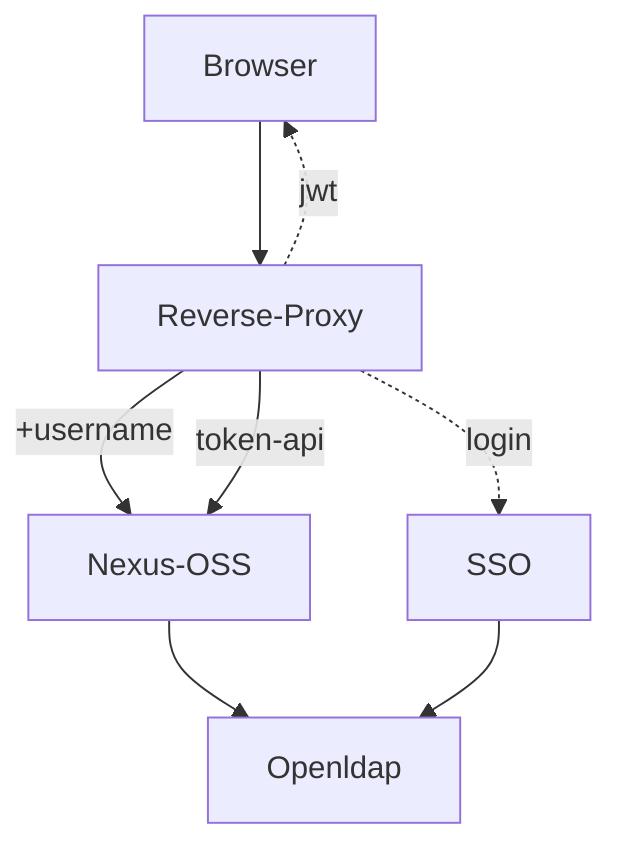

# Reverse Proxy for SSO Openid connect

This __Golang__ application is used to:

* centralize tools on a single entry point (front end)
* dispatch requests (paths) to the different tools
* authenticate some “paths” using openidconnect
* transmit the user identifier to the tool in the request header
* let other paths through without handling authentication (for APIs)
* filter some “paths” based on incoming IP addresses
* restrict some paths to blank list of users
* handle the HTTPS protocol and certificate at the front end
* customize or patch css, js, image, html requests
* automate a basic login (POST formdata), custom filtering
* automate centralized logout
  
Thus, tools that do not natively support openidconnect management for free (for example Sonatype Nexus OSS, Openproject, ...) can rely on this proxy, a SSO and a LDAP to manage their web authentication in openidconnect mode, according to the following diagram:



API-mode access (npm, maven, docker, etc.) to Nexus-OSS is handled by an API token created and controlled within Nexus.

This SSO reverse proxy is simpler to configure and deploy than an Apache2 Httpd with OIDC modules, or Nginx, or LemonLdap, etc.

It is not designed to handle large volumes of requests; however, for managing development tools, it is sufficient.

Authenticated web sessions are stored in a JWT cookie. API access is handled by tokens within each tool behind the reverse proxy.

## Build

With static libraries: 
- CGO_ENABLED=0 go build -o proxy.bin

Full update
- go get -u all
- go mod tidy

## Dependencies 

* Golang      ( Go Language development )
* Zitadel V3  ( Oauth2 OIDC library )
* Goja        ( Go/javascript runtime )
* Ldap V3 
* Yaml V4
* Jwt V3

## Test

Test with Zitadel OIDC Provider and Gitlab OIDC Provider  
Test with Mantis-BT , Nexus-OSS and Openproject Clients

## Install

/example
* proxy.bin : executable
* proxy.yml : configuration
* custom / certificates and key : for HTTPS clients, server
* custom / js files : for automation, patch, custom filtering
* resources / static css, img ... provided by web proxy
* note : on docker, mount volume for custom configuration files
* note : TODO on docker, some ENV variables

## Http Endpoints

Depending on the proxy.yml configuration, the available endpoints are:

For OIDC tools
* https://myhost/frontal/login
* https://myhost/frontal/logout
* https://myhost/frontal/callback  
  
For end users
* https://myhost/tools1/…
* https://myhost/tools2/…
* https://myhost/tools3/…
* https://myhost/tools4/…  
* https://myhost/resources/…

For supervision 
* https://myhost/healthz/ready
* https://myhost/healthz/live

# Configuration 

Into proxy.yml, localized into current workdir of processus

```yaml
# Http Service 
proxy:
  listenip: 0.0.0.0
  port: "8443"
  protocol: https
  certfile: ./custom/server-chain.crt
  keyfile: ./custom/server.key
  usedurl: https://localhost:8443
  tokensecret: ************ 
  agecookie: session  # or age in seconds 43200=12h
  userheader : X-Forwarded-User
  resourcespath : "/resources/"
  trace : false

# Auth Openid connect
openidc:
  active: true
  issuer: http://localhost:8008/oidc # /.well-known/openid-configuration
  ident: frontal
  secret: *************
  loginpath: /frontal/login
  callback: https://localhost:8443/frontal/callback
  frontlogout: https://localhost:8443/frontal/logout
  scope: [ "openid", "profile", "email", "role" ]  
  authmethod: query   # or fragment or form_post 
  uidfield: sub       # or preferred_username
  rootca: ./custom/rootCA.pem

# Proxifications
backends:
  - path : "/nexus/"
    url : "http://localhost:8081/nexus/"
  - path : "/v2/mydocker/"
    url : "http://localhost:8092/v2/mydocker/"
  - path : "/v2/"
    url : "http://localhost:8091/v2/"
  - path : "/mantis/"
    url : "http://localhost:8086/mantis/"
  - path : "/openproject/"
    url : "http://localhost:8080/openproject/"
  - path : "/client/"
    url : "http://localhost:8008/client/"
  - path : "/oidc/"
    url : "http://localhost:8008/oidc/"
  #- host : "*.local.loc"
  #  path : "/example/"
  #  url : "http://back.loc:8080/example/"

# Filtering, Automation
locations:
  - path : "/nexus/registry"
    auth : false
  - path : "/nexus/service/rest/"
    auth : false 
  - path : "/nexus/"
    auth : true
  - path : "/openproject/assets/logo_openproject_white_big-2c...a1.png"
    phfile : "./resources/mylogo.png"
  - path : "/openproject/login"
    auth: true
    execjs : "./custom/op_autologin.js"

  #- path : "/example"
  #  auth : true
  #  users : "admin,other"
  #  iplist : "10.57.0.0/8|10.57.1.45" 
  #  content : "SGVsbG8sIFdvcmxkIQ=="  # Hello, world ! en base64
  #  phfile : "./resources/logo.png" 
  #  execjs : "./custom/auth.js"
```

# Customisation

### Example 1 

Login with Rut Realm (Http Header Auth) for Sonatype Nexus OSS 
* Config nexus auth with rut realm , and Rut capability : X-Forwarded-User
* Config ldap nexus on same as ldap as oidc provider 
* Config proxy userheader : X-Forwarded-User
* Config Nexus on port 8081, 
* For docker registry , a docker group registry on port 8091, a docker hosted "mydocker" on port 8092
* ( docker pull localhost/... , docker push localhost/mydocker/... )

```
backends:
  - path : "/nexus/"
    url : "http://localhost:8081/nexus/"
  - path : "/v2/mydocker/"
    url : "http://localhost:8092/v2/mydocker/"
  - path : "/v2/"
    url : "http://localhost:8091/v2/"

locations:
  - path : "/nexus/registry"
    auth : false
  - path : "/nexus/service/rest/"
    auth : false 
  - path : "/nexus/"
    auth : true
```

### Example 2 

Change logo of a free instance of Openproject

```
  - path : "/openproject/assets/logo_openproject_white_big-2c...a1.png"
    phfile : "./resources/mylogo.png"
```

Difficulty : path to update at each openproject update.

### Example 3

Login with sso oidc provider for a free instance of OpenProject

requirements:
* openproject free installed with context   --env RAILS_RELATIVE_URL_ROOT=/openproject 
* all users created with FIXED complex password in openproject ( the same for all ), just admin is able to create users
* admin user  with its own password ( for security : he must authenticate 1st in sso & 2nd in native openproject )
* an openid provider installed as sso , and configured into this proxy : it manages the centralized credentials

```
backends:
  - path : "/openproject/"
    url : "http://localhost:8080/openproject/"

locations:
  - path : "/openproject/login"
    auth: true
    execjs : "./custom/op_autologin.js"
```

File __op_autologin.js__ :
```
const password = "xxxxxxxxxx"  // The all users password in openproject, known only by admin
                               // the true user password is in oidc provider annuary 

function jsexec()
{
   // On Get Openproject Login  ==> get login req id (csrf) + rewrite to Post login, with form-data to authenticate
   if ( Remote_User !== "admin" && Method == "GET" && Backend_URL.endsWith("/login") ) {

        // Use frontend url to get login page, not backend url , because strict controls of openproject !
        const page = httpCall(Method, Frontend_URL, "", "", Cookie) 

        // Find into login page the hidden request id  ( csrf security )
        const pos = page.indexOf('<input type="hidden" name="authenticity_token" value="');
        const fin = page.indexOf('"',pos+54)
        const reqid = page.substring(pos+54,fin);

        // Create formdata to automate authentication 
        const fdata = "authenticity_token=" + reqid + "&username=" + Remote_User + "&password=" + password

        // Transform the initial Get login to immediate Post login, with form data  (Automation: no login page displayed)
        return ({     
                    "Method": "POST",
                    "Content-Type": "application/x-www-form-urlencoded",
                    "Body": fdata   
                    // Content-length : auto
                })
    }
    // Else Normal proxified Request  ( for admin login page will be displayed for 2nd auth level )
    return ({ })
}

// Return to golang
jsexec()
```
