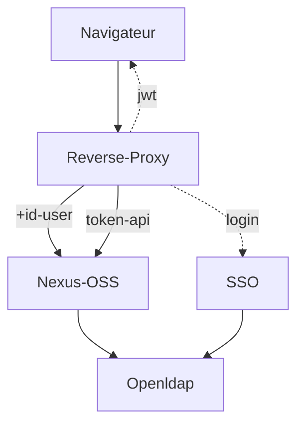

# Reverse Proxy for SSO Openid connect

__Coming soon ...__

This Golang application is used to:

* centralize tools on a single entry point (front end)
* dispatch requests (paths) to the different tools
* authenticate some “paths” using openidconnect
* transmit the user identifier to the tool in the request header
* let other paths through without handling authentication (for APIs)
* filter some “paths” based on incoming IP addresses
* restrict some paths to blank list of users
* handle the HTTPS protocol and certificate at the front end
* customize or patch css, js, image, html requests
* automate a basic login, custom filtering
* automate centralized logout
  
Thus, tools that do not natively support openidconnect management for free (for example Sonatype Nexus OSS, Openproject, ...) can rely on this proxy, a SSO and a LDAP to manage their web authentication in openidconnect mode, according to the following diagram:



API-mode access (npm, maven, docker, etc.) to Nexus-OSS is handled by an API token created and controlled within Nexus.

This SSO reverse proxy is simpler to configure and deploy than an Apache2 Httpd with OIDC modules, or Nginx, or LemonLdap, etc.

It is not designed to handle large volumes of requests; however, for managing development tools, it is sufficient.

Authenticated web sessions are stored in a JWT cookie. API access is handled by tokens within each tool behind the reverse proxy.

## Build
With static libraries: 
- CGO_ENABLED=0 go build -o proxy.bin

Full update
- go get -u all
- go mod tidy

## Install
/example
* proxy.bin : executable
* proxy.yml : configuration
* certificates and key : for HTTPS clients, server
* mount volume for custom configuration files

## Usage
Depending on the proxy.yml configuration, the available endpoints are:

For OIDC tools
* https://myhost/frontal/login
* https://myhost/frontal/logout
* https://myhost/frontal/callback  
  
For end users
* https://myhost/tools1/…
* https://myhost/tools2/…
* https://myhost/tools3/…
* https://myhost/tools4/…  
* https://myhost/resources/…

For supervision  (kubernetes)
* https://myhost/healthz/ready
* https://myhost/healthz/live

# Configuration 

Into proxy.yml, current workdir

```yaml
# Http Service 
proxy:
  listenip: 0.0.0.0
  port: "8443"
  protocol: https
  certfile: server-chain.crt
  keyfile: server.key
  usedurl: https://localhost
  tokensecret: MonPrecieux 
  agecookie: session           # or age in seconds 43200=12h
  userheader : REMOTE_USER
  contextpath : "/frontal"     # for oidc endpoints
  
# Auth Openid connect
openidc:
  active: false
  issuer: https://localhost/oidc     # /.well-known/openid-configuration
  ident: frontal
  secret: lusseaux
  loginpath: /frontal/login
  callback: https://localhost/frontal/callback
  #postlogout: https://localhost/agrem/vue/home
  frontlogout: https://localhost/frontal/logout
  scope: [ "openid", "profile", "email", "role" ]  
  authmethod: query     # or fragment or form_post 
  uidfield: sub         # or preferred_username
  rootca: rootCA.pem

backends:    ## Proxy list , in order 
  - host : "*.local.loc"
    path : "/example/"
    url : "http://back.loc:8080/example/"
  - path : "/mantis/"
    url : "http://localhost:8086/mantis/"
  - path : "/client/"
    url : "https://agrem.loc:8008/client/"
  - path : "/oidc/"
    url : "https://agrem.loc:8008/oidc/"

locations:   ## Filter list , in order 
  - path : "/exemple/ici/logo.png"
    phfile : "./files/mon-logo.png"      # place holder file
  - path : "/openproject/form/login"
    execjs : "./js/autom_login.js"       # ex: do  Get login + post login with user from oidc
  - path : "/example"
    auth : true                         # require authentification (on oidc provider)
    users : "admin,other"               # only usernames authorized
    iplist : "10.57.0.0/8|10.57.1.45"   # only source ip range authorized
```

# Customisation

#### Exemple 1 

Login with RuthRealm  for Sonatype Nexus OSS 

#### Example 2 

Change logo of a free instance of Openproject

#### Exemple 3

Login with sso oidc for a free instance of OpenProject

#### Exemple 4 

Logout all of tools  
